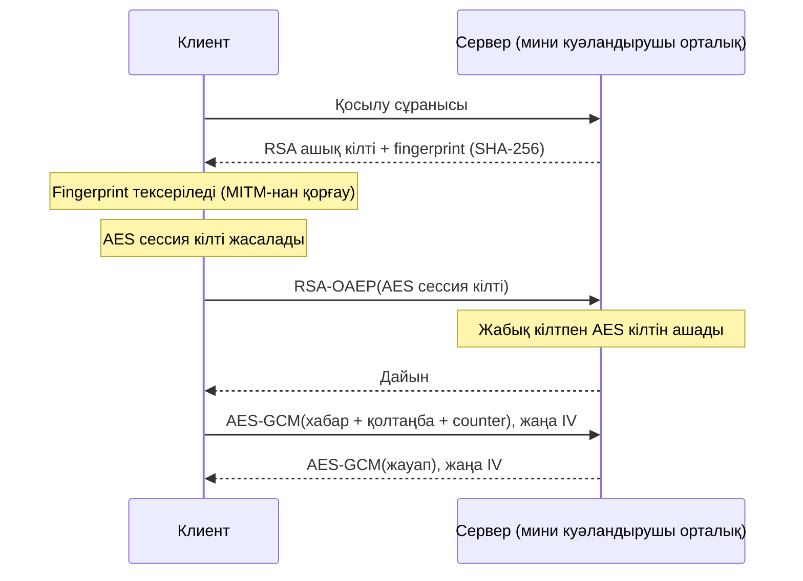
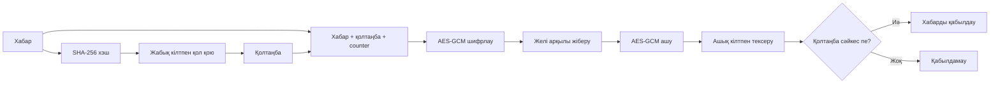
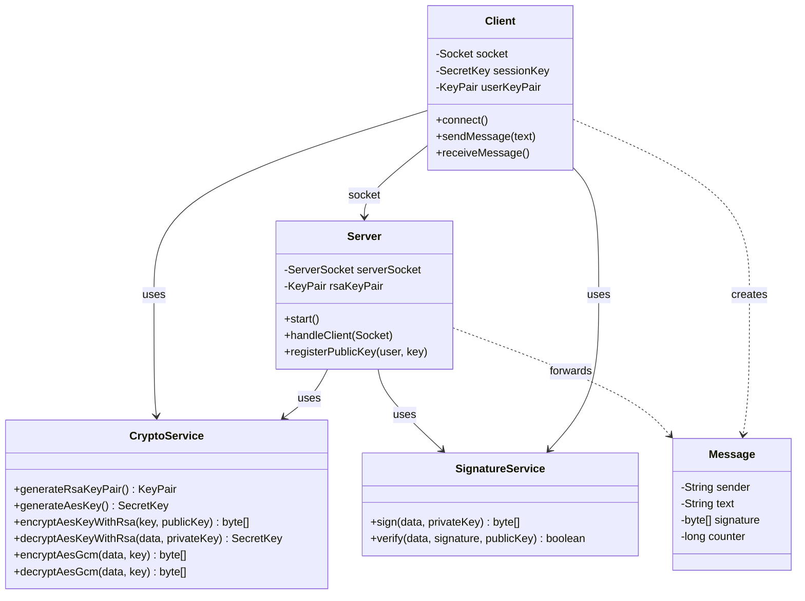
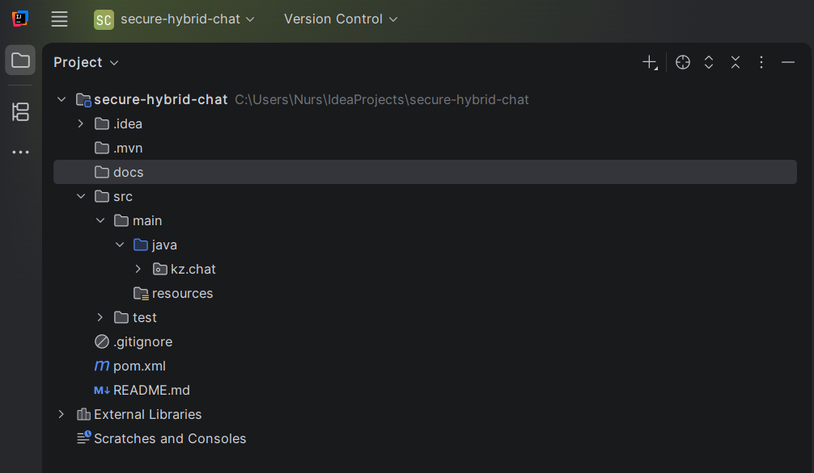

# Secure Hybrid Chat

Гибридті шифрлаумен және цифрлық қолтаңбамен қорғалған клиент–сервер чат (Java, сокеттер, JCA).

## Мақсаты
Екі пайдаланушы арасындағы хабарды қорғау: құпиялылық (AES-GCM), кілт алмасу (RSA),
түпнұсқалықты растау (SHA256withRSA қолтаңбасы). Жоба eGov ЭЦП және TLS идеяларынан шабыттанған.

## Research
Толық зерттеу: [docs/research.md](docs/research.md)

### Мәселе
Интернетте хабарды үшінші тарап оқуы немесе өзгертуі мүмкін. Керек: құпиялылық және түпнұсқалық.

### Шифрлау түрлері
- Симметриялы (AES): жылдам, бірақ кілтті жеткізу қиын.
- Асимметриялы (RSA): кілт алмасуға жақсы, бірақ баяу.

### Гибридті шифрлау
Клиент AES сессия кілтін жасайды, оны сервердің RSA ашық кілтімен шифрлап жібереді,
одан кейін барлық хабар AES-GCM-мен шифрланады. Әр хабарға жаңа IV (12 байт) қолданылады.

### ЭЦП
Хабардың SHA-256 хэшіне жабық кілтпен қол қойылады (SHA256withRSA), алушы ашық кілтпен тексереді.

### eGov-та қолданылуы
- Қосылым TLS арқылы қорғалады.
- ЭЦП кілті (.p12) НУЦ РК береді: жабық кілт + сертификат.
- Кіру: сайт challenge жібереді, NCALayer жабық кілтпен қол қояды, сайт тексереді.
- Құжатқа қол қою: құжат хэшіне қол қойылады.
- Ашық кілттің иесін НУЦ РК сертификаты растайды (PKI).

### Салыстыру
| Жүйе | Кілт алмасу | Шифрлау | Растау |
|---|---|---|---|
| TLS/HTTPS | ECDHE/RSA | AES-GCM | Сайт сертификаты |
| Signal | X3DH | AES + Double Ratchet | Safety number |
| eGov ЭЦП | - | қол қою | НУЦ РК сертификаты |

### Қауіптер
MITM, IV қайта қолдану, replay шабуылы, жабық кілтті ашық сақтау.

### Жоспарланған қосымша мүмкіндіктер
- Safety number (кілт саусақ ізін салыстыру)
- Replay шабуылынан қорғау (counter/timestamp)
- Жабық кілтті парольмен қорғау (PBKDF2 + AES-GCM)
- Сервер мини куәландырушы орталық ретінде

## Орнату
```bash
git clone https://github.com/Nurs08-is/secure-hybrid-chat.git
cd secure-hybrid-chat
mvn clean install
```

## Қолдану мысалы
```bash
java -cp target/classes kz.chat.Server
java -cp target/classes kz.chat.Client
```
(Жоба дамыған сайын жаңартылады.)


## Диаграмма

### 1. Қосылу және кілт алмасу



### 2. Хабарға қол қою және тексеру

### 3. Кластар диаграммасы (UML)

## Қауіпсіздік ескертпесі
- Жабық кілттер репозиторийге салынбайды (`.gitignore`).
- Әр хабарға жаңа IV қолданылады.
- Криптография стандартты JCA арқылы жасалады, өз алгоритм ойлап табылмайды.
- Бұл оқу жобасы, өндірістік қолдануға арналмаған.

## Жоба құрылымы


## Лицензия
MIT
